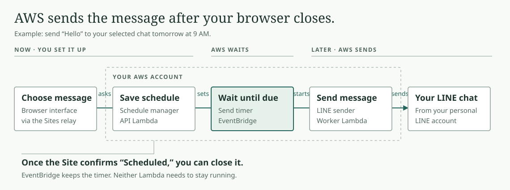

# LINE Scheduler

LINE has stickers for every possible mood. A “send later” button? Apparently that was asking too much.

So I built one: a private front end on **ChatGPT Sites**, with a small **AWS serverless sender** behind it. Pick a chat, write a message or drop in a file, choose a time, and close the laptop. It sends from your personal LINE account to your existing conversations.

## What it does

- Send now or schedule for later, with an explicit time zone.
- Drag and drop images, text files, or other documents: up to five files, 20 MiB each.
- Send text and each attachment as separate messages; cancel pending sends and review receipts.
- Require LINE Letter Sealing. No silent downgrade and no automatic resend after an uncertain outcome.

Images arrive as **file attachments**, not native photo bubbles. Native image sending is disabled because of an encryption flaw in the inherited format. Message order within a batch is not guaranteed.

## How a scheduled message gets sent

You choose the message and time. **AWS remembers the schedule and sends through
your LINE account, even after you close the browser.**

Two separate AWS functions do the work: the **schedule manager** saves your
request; the **LINE sender** runs when the timer calls it. Neither function stays
running while it waits. EventBridge Scheduler keeps the timer.

**Login and reconnect happen in the private Site.** Choose Connect/Reconnect LINE, scan the QR using LINE on your phone, and approve. AWS securely saves the session; Sites never receives the LINE credentials. Your laptop can be off after setup.

The [architecture guide](docs/ARCHITECTURE.md) follows one message, shows
[what runs where](docs/ARCHITECTURE.md#what-runs-where), and explains login,
uploads, and recovery. A [step-through HTML version](docs/architecture.html) is
also included: download it and open it in a browser; GitHub shows its source.
GitHub holds the source and deployment instructions; the running copies live on Sites and AWS.

## Build your own

- [Frontend source and Sites setup](web/README.md)
- [AWS deployment, security boundaries, and operations](deploy/aws/README.md)
- [CLI build and usage](https://github.com/punnkrit/line-scheduler-client/blob/main/docs/CLI.md)
- [Security review and remaining risks](https://github.com/punnkrit/line-scheduler-client/blob/main/docs/FORK_SECURITY.md)
- [V2 compatibility evidence](https://github.com/punnkrit/line-scheduler-client/blob/main/docs/V2_COMPATIBILITY.md)

The sender comes from **[line-scheduler-client](https://github.com/punnkrit/line-scheduler-client)**, our hardened fork of [kongesque/line-cli](https://github.com/kongesque/line-cli). This app pins its exact commit in `client.lock.json`. Build it with **Go 1.27.3** using `python3 scripts/build_sender.py`; upstream installers do not contain its changes. This repository includes synthetic tests and sanitized frontend source, never live credentials, messages, contact lists, or deployment identifiers.

This is an unofficial personal project. LINE can revoke sessions or change its protocol. “Sent” means LINE accepted the message, not that someone read it. AWS scheduling has minute-level precision, and an uncertain send needs a manual check in LINE. Small usage is intended to be inexpensive; free credits and recurring service allowances are separate, and a zero bill is not guaranteed.

## Thanks

Built on [Kongesque’s LINE CLI](https://github.com/kongesque/line-cli) and its [Beeper LINE](https://github.com/beeper/line) origins. Their work made this possible. The client fork retains upstream history and copyright notices. This application is also released under the [MIT License](LICENSE).

Not affiliated with LINE, LY Corporation, or OpenAI.
