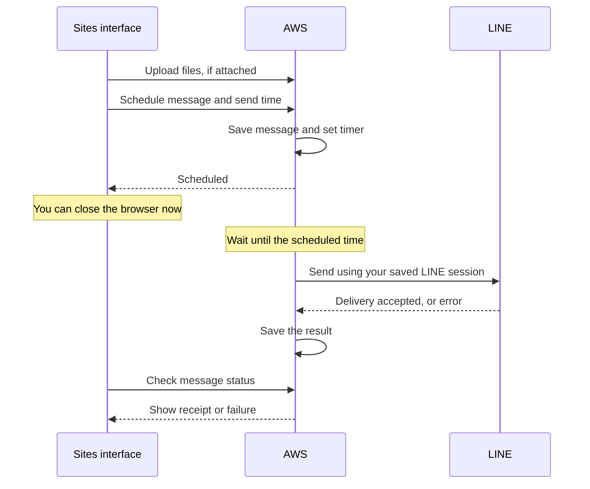
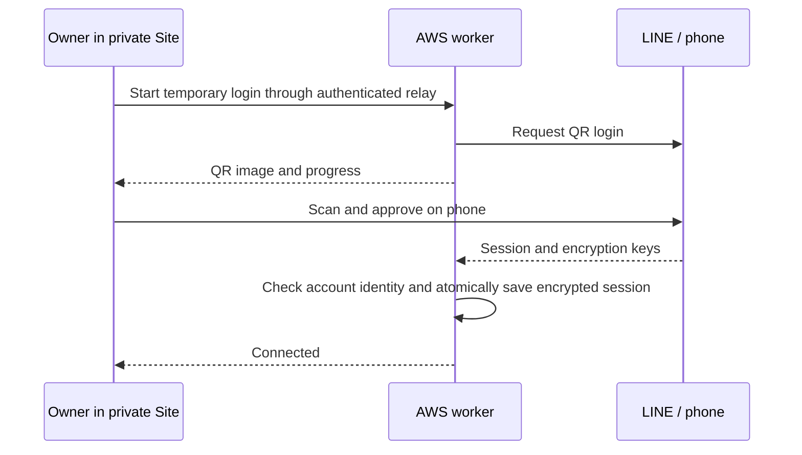

# What runs where?

The goal: write a LINE message now, deliver it later, close the laptop.
Sites supplies the private interface; AWS supplies the clock and sender.
There is no AI agent deciding when or what to send.

Read from top to bottom. **Sites is where you compose; AWS waits and sends; LINE
receives the message.** The browser is only needed when scheduling or checking
status. A receipt means LINE accepted the message, not that the recipient read it.

Inside AWS, Lambda runs the code, EventBridge supplies the timer, DynamoDB stores
jobs and the encrypted session, and S3 temporarily holds attachments. These are
parts of the same cloud backend—not additional apps you need to keep open.

## Two repositories

- **line-scheduler (this repo):** Sites interface, AWS infrastructure, scheduling, uploads, and documentation.
- **[line-scheduler-client](https://github.com/punnkrit/line-scheduler-client):** hardened LINE protocol/client and `cmd/cloudline`, the small stdin/stdout adapter used by Lambda.

`client.lock.json` pins the client repository, commit, and Go toolchain. `scripts/build_sender.py` builds that commit into ignored deployment binaries. We do not vendor the protocol source or track a moving branch at deploy time. Updating the client is a deliberate lock-file change after review and tests.

## Three logins, three different jobs

| Login | What it does | Where it lives |
| --- | --- | --- |
| ChatGPT | Lets the owner open the private Site | Sites handles browser sign-in and supplies trusted identity headers |
| AWS | Lets the operator deploy and maintain infrastructure | Temporary AWS CLI credentials; not needed for each scheduled send |
| LINE | Lets the sender act as your personal account | Approved using the private Site QR and LINE on your phone; stored encrypted in AWS |

**The Site does not log you into LINE.** Its “LINE connected” indicator reports the
sender's last connection check. Signing into ChatGPT alone cannot establish a LINE
session, and closing or signing out of the Site does not cancel accepted schedules.

## LINE sign-in and reconnect

After initial deployment, login and reconnect happen entirely online:

1. Open the private Site and choose **Connect LINE** or **Reconnect LINE**.
2. Select **Show QR code**. Scan using LINE on your phone and approve the login.
   If a verification code appears, enter it in LINE on your phone.
3. AWS saves the encrypted session and the Site refreshes your conversations.
   Your laptop and browser are not involved in later scheduled sends.

The QR must be displayed on a screen that your LINE phone can scan. The current
flow does not add a same-phone deep-link login; another screen may be needed.
No desktop LINE installation or local terminal is required for this flow.

A login worker runs for at most about 105 seconds. Attempts expire, and **Cancel
login** stops the attempt. Only one login may be reserved at a time, with a
one-minute start cooldown. Reloading the page can resume the same attempt using
an opaque tab-session identifier; QR content and PINs are never stored in browser
storage. If the browser closes, the attempt expires automatically.

The account lease serializes login with sends. Jobs that become due during login
can be delayed and retried before any send is claimed. Already claimed/uncertain
sends are never replayed. Reconnecting must approve the **same LINE account**;
a different account is rejected before the stored session is replaced.

Session replacement, attempt completion, display removal, and invalidation of the
cached conversation list happen in one DynamoDB transaction. The transaction
checks the lease, session version, attempt ID, status, and expiry. If cancellation
wins, replacement cannot commit; if replacement wins, cancellation reports success
instead of pretending the saved session was undone. A lost response cannot start
a second login for the same attempt.

The encryption key is in the worker Lambda's encrypted environment; the session
ciphertext is in a separate DynamoDB table. Sites holds neither. Temporary QR/PIN
display events are encrypted with a **different key**, authenticated to their
attempt ID, and stored briefly in the jobs table. The API can decrypt only these
display events, not the LINE session. Display ciphertext is removed on completion,
cancellation, or observed expiry; DynamoDB TTL provides asynchronous cleanup after
one day if an invocation is interrupted. Expired display data is never returned.

The Site relay requires ChatGPT sign-in and same-origin JSON requests; the Site
must remain owner-private. QR images are rendered by the bundled client, with no
external QR service. Codes, tokens, and protocol bodies are excluded from logs.
An AWS administrator with access to the worker and session table remains trusted.

If login fails after phone approval, LINE may already have invalidated the old
session even though a new one was not saved. Retry through the Site; never restore
an old session snapshot. The **Refresh conversations** button can recheck an
existing session after an interrupted or cancelled login. Failed/uncertain jobs
are not automatically resent by reconnecting.

The local Windows QR and encrypted migration tools remain as an optional initial
bootstrap path. They are deployment/maintenance tools, not a tunnel or runtime
dependency. The normal migration command refuses to overwrite an existing session.

## Sending text and files

1. Choose a conversation, compose text and/or attach files, and select a time zone
   and date. Drag-and-drop and the file picker accept up to five files, 20 MiB each.
2. On submission, the browser hashes each file and obtains a five-minute S3 upload
   form through the authenticated Site relay. Its permission fixes the object key,
   size, encryption setting, and staging tag. File bytes go directly to private S3.
3. AWS records each message as its own job. For attachments it pins an immutable
   S3 version. A later upload cannot change the version scheduled for delivery.
4. EventBridge invokes the worker at the chosen time. The worker claims the job,
   restores the encrypted LINE session, checks attachment size and SHA-256, and
   sends once with Letter Sealing required.
5. The history shows LINE's receipt or a safe failure/uncertain status. Reloading
   or retrying the same submitted job ID does not send a second copy.

Text and each attachment are separate LINE messages and separate jobs. Their
arrival order is not guaranteed. A batch is not an atomic transaction: if a later
submission fails, already accepted messages remain scheduled and appear separately
in history. The interface removes accepted items and preserves remaining draft
items. Check history before creating a new request after an uncertain response.

**Images send as generic files**, preserving their original bytes. Native photo
messages remain disabled because the inherited full-image/preview encryption format
reuses an encryption stream. The scheduler never works around that by downgrading
encryption. Generic-file interoperability is separate from text support.

## Storage and cleanup

| Data | Location | Lifetime |
| --- | --- | --- |
| Unsaved draft | Browser memory | Until refresh/close; no draft sync |
| Job text, recipient, filename, hash, receipt | DynamoDB jobs table | TTL 90 days after due time; deletion is asynchronous |
| File bytes | Private, versioned, server-encrypted S3 bucket | Exact version deleted after completion/cancellation when possible |
| Abandoned upload | S3, tagged staging | Current version expires after one day; noncurrent staging versions after one more day; cleanup is asynchronous |
| Scheduled file left after an interrupted cleanup | S3 | Current versions expire after 370 days; noncurrent scheduled versions after 370 more days (up to about 740 days total) |
| LINE tokens, keys, request sequence | Encrypted DynamoDB session record | Retained for the active account |
| Hosting bridge secret | Sites server runtime and API Lambda | Until rotated; never browser code |

File names and contents are not made public. Generic files retain any metadata
already inside them; the scheduler does not strip EXIF or scan for malware.
Uploading to your AWS account is not end-to-end encryption against AWS: AWS storage
encryption protects files at rest, and LINE Letter Sealing protects the LINE send.

## Timing and failure behavior

AWS scheduling is minute-level, not an exact-second alarm. The account lease
serializes LINE operations; congestion, network problems, or expired credentials
can delay a send. Jobs more than 15 minutes late expire. An ambiguous send becomes
**Check LINE** and is never automatically replayed. This avoids duplicate personal
messages at the cost of possibly missing a send after a failure.

The browser, local terminal, and deployment CLI are not part of scheduled execution.
AWS account suspension or exhausted account-plan access can stop the service.
Low traffic is inexpensive but not a promise of an indefinite zero bill; S3 storage,
requests, logs, and service allowances still apply.

See [deployment and operations](../deploy/aws/README.md) for commands and
[security review limits](https://github.com/punnkrit/line-scheduler-client/blob/main/docs/FORK_SECURITY.md) before using a personal account.
