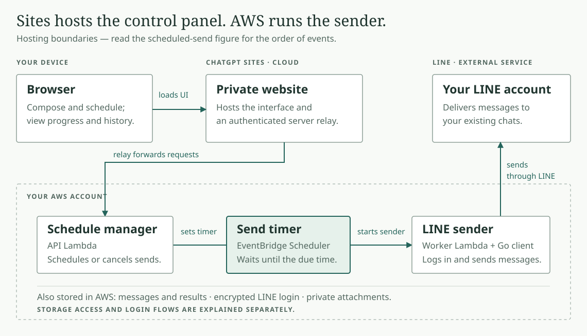
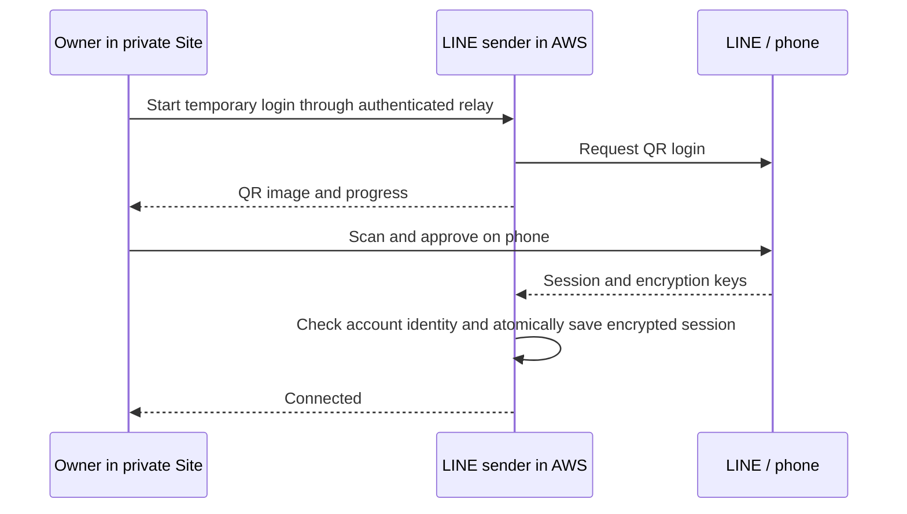
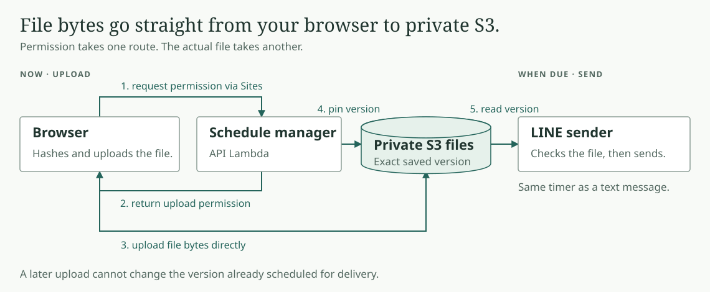

# LINE Scheduler architecture

**You choose a message and a time. AWS remembers the schedule and sends through
your LINE account.** Your browser and laptop can close after the schedule is accepted.

Start with [one scheduled message](#follow-one-scheduled-message), then look at
[what runs where](#what-runs-where). [LINE login](#line-sign-in-and-reconnect) and
[file uploads](#sending-text-and-files) each have their own explanation.

Prefer to step through the flow? Download [the standalone HTML version](architecture.html)
and open it in a browser. GitHub displays HTML source rather than running it.

## Follow one scheduled message

For example: **send “Hello” to a selected LINE chat tomorrow at 9 AM** in the time zone you choose.

[](scheduled-send.svg)

1. **Now: choose the chat, message, and time.** The browser sends your request
   through the private Sites relay to the AWS **schedule manager**.
2. **Now: save the message and set the timer.** The schedule manager stores the
   message, recipient, and due time in DynamoDB, then creates an EventBridge schedule.
   Wait for the Site to confirm **Scheduled** before closing it. If the response is
   uncertain, refresh history to check the existing request.
3. **While you are away: AWS waits.** EventBridge holds the timer. The browser,
   schedule manager, and LINE sender do not need to keep running.
4. **When due: send through LINE.** EventBridge starts the **LINE sender**. It
   reads the saved message, claims the send, and runs the Go LINE client using
   the encrypted LINE login, with Letter Sealing required.
5. **Later: check history.** The sender stores the result in DynamoDB. When you
   reopen the Site, the schedule manager returns that result through the relay.
   A receipt means LINE accepted the message, not that the recipient read it.

The code calls each saved send a **job**: one LINE message, its recipient, due
time, and delivery status. **Cancel send** cancels a pending message before the
sender claims it; it cannot recall a message already being sent.

## What runs where?

**Sites hosts the control panel. Your AWS account holds the schedule, files,
and LINE login.** The map shows hosting boundaries; the previous figure shows order.

[](architecture.svg)

| Name used here | Implementation | Responsibility |
| --- | --- | --- |
| Browser interface | React, served by Sites | Collects the message and time; displays QR, progress, and history |
| Sites relay | Server-side `/api/scheduler` route | Checks ChatGPT sign-in and forwards requests with a server-only secret |
| Schedule manager | API Lambda, `handler.controller` | Schedules or cancels pending messages; returns history and login progress |
| Send timer | EventBridge Scheduler | Starts the LINE sender when the message is due |
| LINE sender | Worker Lambda, `handler.worker`, plus Go `cloudline` | Connects to LINE, sends messages, and stores results |

**Lambda means a function that runs when called.** The schedule manager and LINE
sender are two separate functions; EventBridge does the waiting between calls.
**Send now**, **Refresh conversations**, and **Connect/Reconnect LINE** call the
sender through the schedule manager without creating a timer.

### What survives when a function stops?

- **Messages and results:** the DynamoDB jobs table stores scheduled sends and history.
- **LINE login:** a separate DynamoDB session table stores encrypted tokens and keys.
  Only the LINE sender has access to this table and its decryption key.
- **Attachments:** a private S3 bucket stores the files. Uploads go directly from
  the browser to S3; the sender reads the exact saved version when it sends.
- **Unsaved drafts:** browser memory only. Refreshing or closing the page loses them.

GitHub and your setup computer supply code during deployment; neither participates
in delivery. IAM permissions, CloudWatch logs, and an SQS failure queue support
the backend and are omitted from these figures. No AI agent runs scheduled sends.

### Find each part in the code

- [Browser composer and history](../web/app/scheduler.tsx): schedule requests, direct file uploads, and displayed statuses.
- [Sites relay](../web/app/api/scheduler/route.ts): browser authentication and calls to AWS.
- [Schedule manager and LINE sender](../deploy/aws/handler.py): `controller`, `worker`, upload checks, and client invocation.
- [QR login lifecycle](../deploy/aws/cloud_login.py): temporary login attempts and encrypted session replacement.
- [AWS infrastructure](../deploy/aws/template.py): the two Lambdas, timer permissions, storage, and failure queue.
- [Client version](../client.lock.json) and [client build](../scripts/build_sender.py): the pinned Go client bundled with the sender.

## Two repositories

- **line-scheduler (this repo):** Sites interface, AWS infrastructure, scheduling, uploads, and documentation.
- **[line-scheduler-client](https://github.com/punnkrit/line-scheduler-client):** hardened LINE protocol/client and `cmd/cloudline`, the small stdin/stdout adapter used by Lambda.

`client.lock.json` pins the client repository, commit, and Go toolchain. `scripts/build_sender.py` builds that commit into ignored deployment binaries. We do not vendor the protocol source or track a moving branch at deploy time. Updating the client is a deliberate lock-file change after review and tests.

## Three logins, three different purposes

| Login | What it does | Where it lives |
| --- | --- | --- |
| ChatGPT | Lets the owner open the private Site | Sites handles browser sign-in and supplies trusted identity headers |
| AWS | Lets the operator deploy and maintain infrastructure | Temporary AWS CLI credentials; not needed for each scheduled send |
| LINE | Lets the sender act as your personal account | Approved using the private Site QR and LINE on your phone; stored encrypted in AWS |

**ChatGPT sign-in and LINE sign-in are separate.** ChatGPT opens the private Site;
Connect/Reconnect LINE starts the AWS-hosted QR flow. The “LINE connected” indicator
reports the sender's last connection check. Closing or signing out of the Site does
not cancel accepted schedules.

## LINE sign-in and reconnect

After initial deployment, login and reconnect happen entirely online.

This is a setup/reconnect flow, separate from the send timer. Here “LINE sender”
means the worker Lambda; requests and QR progress pass through the Sites relay
and schedule manager.



1. Open the private Site and choose **Connect LINE** or **Reconnect LINE**.
2. Select **Show QR code**. Scan using LINE on your phone and approve the login.
   If a verification code appears, enter it in LINE on your phone.
3. AWS saves the encrypted session and the Site refreshes your conversations.
   Your laptop and browser are not involved in later scheduled sends.

The QR must be displayed on a screen that your LINE phone can scan. The current
flow does not add a same-phone deep-link login; another screen may be needed.
No desktop LINE installation or local terminal is required for this flow.

A login worker runs for at most about 105 seconds. Attempts expire, and **Cancel
login** stops the attempt. Only one login may be reserved at a time, with a
one-minute start cooldown. Reloading the page can resume the same attempt using
an opaque tab-session identifier; QR content and PINs are never stored in browser
storage. If the browser closes, the attempt expires automatically.

The account lease serializes login with sends. Jobs that become due during login
can be delayed and retried before any send is claimed. Already claimed/uncertain
sends are never replayed. Reconnecting must approve the **same LINE account**;
a different account is rejected before the stored session is replaced.

Session replacement, attempt completion, display removal, and invalidation of the
cached conversation list happen in one DynamoDB transaction. The transaction
checks the lease, session version, attempt ID, status, and expiry. If cancellation
wins, replacement cannot commit; if replacement wins, cancellation reports success
instead of pretending the saved session was undone. A lost response cannot start
a second login for the same attempt.

The encryption key is in the worker Lambda's encrypted environment; the session
ciphertext is in a separate DynamoDB table. Sites holds neither. Temporary QR/PIN
display events are encrypted with a **different key**, authenticated to their
attempt ID, and stored briefly in the jobs table. The API can decrypt only these
display events, not the LINE session. Display ciphertext is removed on completion,
cancellation, or observed expiry; DynamoDB TTL provides asynchronous cleanup after
one day if an invocation is interrupted. Expired display data is never returned.

The Site relay requires ChatGPT sign-in and same-origin JSON requests; the Site
must remain owner-private. QR images are rendered by the bundled client, with no
external QR service. Codes, tokens, and protocol bodies are excluded from logs.
An AWS administrator with access to the worker and session table remains trusted.

If login fails after phone approval, LINE may already have invalidated the old
session even though a new one was not saved. Retry through the Site; never restore
an old session snapshot. The **Refresh conversations** button can recheck an
existing session after an interrupted or cancelled login. Failed/uncertain jobs
are not automatically resent by reconnecting.

The local Windows QR and encrypted migration tools remain as an optional initial
bootstrap path. They are deployment/maintenance tools, not a tunnel or runtime
dependency. The normal migration command refuses to overwrite an existing session.

## Sending text and files

**The browser uploads file bytes directly to S3.** The Sites relay and schedule
manager arrange permission; they do not carry the upload. The file's saved version
then follows the same timer-and-sender path as a text message.

[](file-upload.svg)

1. Choose a conversation, compose text and/or attach files, and select a time zone
   and date. Drag-and-drop and the file picker accept up to five files, 20 MiB each.
2. On submission, the browser hashes each file and obtains a five-minute S3 upload
   form through the authenticated Site relay. Its permission fixes the object key,
   size, encryption setting, and staging tag. File bytes go directly to private S3.
3. AWS records each message as its own job. For attachments it pins an immutable
   S3 version. A later upload cannot change the version scheduled for delivery.
4. EventBridge invokes the worker at the chosen time. The worker claims the job,
   restores the encrypted LINE session, checks attachment size and SHA-256, and
   sends once with Letter Sealing required.
5. The history shows LINE's receipt or a safe failure/uncertain status. Reloading
   or retrying the same submitted job ID does not send a second copy.

Text and each attachment are separate LINE messages and separate jobs. Their
arrival order is not guaranteed. A batch is not an atomic transaction: if a later
submission fails, already accepted messages remain scheduled and appear separately
in history. The interface removes accepted items and preserves remaining draft
items. Check history before creating a new request after an uncertain response.

**Images send as generic files**, preserving their original bytes. Native photo
messages remain disabled because the inherited full-image/preview encryption format
reuses an encryption stream. The scheduler never works around that by downgrading
encryption. Generic-file interoperability is separate from text support.

## Storage and cleanup

| Data | Location | Lifetime |
| --- | --- | --- |
| Unsaved draft | Browser memory | Until refresh/close; no draft sync |
| Job text, recipient, filename, hash, receipt | DynamoDB jobs table | TTL 90 days after due time; deletion is asynchronous |
| File bytes | Private, versioned, server-encrypted S3 bucket | Exact version deleted after completion/cancellation when possible |
| Abandoned upload | S3, tagged staging | Current version expires after one day; noncurrent staging versions after one more day; cleanup is asynchronous |
| Scheduled file left after an interrupted cleanup | S3 | Current versions expire after 370 days; noncurrent scheduled versions after 370 more days (up to about 740 days total) |
| LINE tokens, keys, request sequence | Encrypted DynamoDB session record | Retained for the active account |
| Hosting bridge secret | Sites server runtime and API Lambda | Until rotated; never browser code |

File names and contents are not made public. Generic files retain any metadata
already inside them; the scheduler does not strip EXIF or scan for malware.
Uploading to your AWS account is not end-to-end encryption against AWS: AWS storage
encryption protects files at rest, and LINE Letter Sealing protects the LINE send.

## Timing and failure behavior

AWS scheduling is minute-level, not an exact-second alarm. The account lease
serializes LINE operations; congestion, network problems, or expired credentials
can delay a send. Jobs more than 15 minutes late expire. An ambiguous send becomes
**Check LINE** and is never automatically replayed. This avoids duplicate personal
messages at the cost of possibly missing a send after a failure.

The browser, local terminal, and deployment CLI are not part of scheduled execution.
AWS account suspension or exhausted account-plan access can stop the service.
Low traffic is inexpensive but not a promise of an indefinite zero bill; S3 storage,
requests, logs, and service allowances still apply.

See [deployment and operations](../deploy/aws/README.md) for commands and
[security review limits](https://github.com/punnkrit/line-scheduler-client/blob/main/docs/FORK_SECURITY.md) before using a personal account.

## Updating the figures

The SVG files next to this guide are editable source and render directly on GitHub.
Keep each figure focused on one question. Use the names above, with AWS service
names as secondary labels. Keep timing and security qualifications in this guide.

The optional HTML walkthrough is generated from [architecture.src.html](architecture.src.html)
with the [visual-explainer skill](https://github.com/nicobailon/visual-explainer).
After editing that source or an SVG, build with the installed skill's renderer.
The helper embeds the SVGs so the generated HTML opens as a single file:

```text
python scripts/build_architecture.py --renderer <visual-explainer-directory>/kit/render.mjs
```

Keep the HTML and SVG versions consistent when the flow changes. Rendering the
walkthrough is a documentation task; it does not deploy the app or contact LINE.
